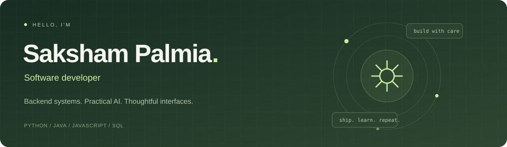

  

  
  
  

## A little about me

I'm Saksham, a software developer interested in turning useful ideas into working software. I enjoy backend development, API design, and building interfaces that make technical tools easier to use.

My current projects explore natural-language data tools, IT workflow automation, and hiring platforms. I'm strengthening my full-stack skills through hands-on work and am open to collaboration, internships, and freelance opportunities.

## Selected projects

| Project | What it does | Built with |
| --- | --- | --- |
| **[QueryMind ↗](https://github.com/Saksham-Palmia/querymind)** | A natural-language PostgreSQL workspace with a responsive UI, SQL inspection, sample mode, and a self-correcting query pipeline. | Python · FastAPI · LangGraph · PostgreSQL |
| **[Veridian IT Service Agent ↗](https://github.com/Saksham-Palmia/Veridian-IT-agent)** | An IT support workflow with employee chat, policy retrieval, ticket creation, and an admin dashboard. | Python · FastAPI · SQLAlchemy · Gemini |
| **[ZidioConnect ↗](https://github.com/Saksham-Palmia/ZidioConnect)** | A hiring-platform backend covering student and recruiter workflows, job applications, and REST APIs. | Java · Spring Boot · MySQL |

A look inside QueryMind — open the repository for the code and local demo.

## Tools I work with

**Languages** · Python, Java, JavaScript, TypeScript, SQL  
**Web** · React, Next.js, HTML, CSS, Tailwind CSS  
**Backend** · FastAPI, Spring Boot, Node.js, Express, REST APIs  
**Data & tooling** · PostgreSQL, MySQL, Git, Docker

## What I'm exploring

- Making AI workflows easier to inspect, test, and use.
- Designing clearer APIs and more reliable backend systems.
- Bringing backend projects to life with useful interfaces and documentation.

---

Have an idea worth building? Reach me on **[LinkedIn](https://www.linkedin.com/in/saksham-palmia/)** or at **[palmiasaksham@gmail.com](mailto:palmiasaksham@gmail.com)**.
